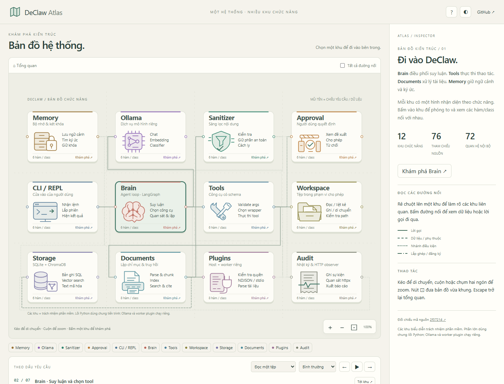

# DeClaw Atlas

A top-down, interactive map of DeClaw. Each software responsibility has a district and a functional landmark: a neural brain, a memory cabinet with a key vault, a document processor, a permission gate, a plugin connector, and more. Click a district to zoom into its source-backed functions and classes.

All visualization code lives in this independent repository. Nothing is added to the DeClaw application.



## Open

Open **index.html** in a browser, or run `npm run dev` and visit http://127.0.0.1:4174. The HTML is self-contained: no install, backend, credentials, model service or external fonts. `index-dark.html` starts in dark mode. GitHub displays HTML source; download the files or use a local preview. The repository remains private; Pages is not enabled.

## Explore

- Click a district or its name below the map. The camera eases into the district and reveals its internal graph. Click a function to zoom closer and inspect its responsibility, inputs, outputs and exact source line.
- Drag to pan. Use the wheel, two-finger pinch, or + / − to zoom. Wheel zoom stays anchored to the cursor. The ⊡ button fits the whole current level. Narrow panels start at a readable neighbourhood scale; pan to adjacent districts or use ⊡ for the complete map.
- Follow the arrows from OUT ports to IN ports. Click a wire to highlight both endpoints, fit them into view, and inspect the typed relationship. Calls, data/dependencies, branches and construction/registration use different line patterns. Hover a district to reveal its neighbours; **Tất cả đường nối** reveals the complete overview wiring.
- The inspector has keyboard-accessible symbol and relation lists. In narrow panels, **Chi tiết ↓** and **Về bản đồ ↑** move between the map and inspector.
- Escape first clears a symbol/wire selection, then returns to the overview. The breadcrumb does the same return in one action. Arrow keys pan the focused map, + / − zoom, Home fits, and Tab + Enter opens a district or symbol.
- Four request simulations cover reads, approved writes, document indexing and retrieval. Denied writes stop before filesystem execution. Unsafe reads/retrieved chunks are withheld. Reduced motion uses immediate camera changes and manual playback steps.
- Hash URLs preserve district, symbol or wire, flow, outcome and step. Old `view=open` URLs still resolve. Browser Back/Forward follows district navigation.

The map contains **12 districts**, **20 inter-district relations**, **76 symbol references to 60 distinct definitions**, and **72 internal relations**. A definition may appear in multiple responsibility views. Static SVG exports are in `assets/declaw-light.svg` and `assets/declaw-dark.svg`.

## Source grounding

Source snapshot: [NgoHung0704/DeClaw at 2f37214](https://github.com/NgoHung0704/DeClaw/tree/2f37214e73cbbdadc8d037ce78d6c0e81a73a1ed). The map is curated against this revision, not a live dependency scanner or telemetry display.

Districts represent responsibilities. Most modules share one local Python process. Ollama is a separate model service; each loaded plugin has a subprocess worker communicating through NDJSON stdio. SQLite and ChromaDB are local storage dependencies. The picture does not represent twelve microservices.

The inspector preserves scope: indexing does not classify the whole corpus; retrieval screens top-k chunks. Chroma text payload encryption does not encrypt vectors or all metadata. The core httpx observer is not an OS firewall. Memory views do not claim every memory type is automatically injected into every agent turn. FastAPI gateway, connected desktop and shell sandbox are deferred work.

No application source, user documents or secrets are bundled. Source links require access to the DeClaw repository.

## Build and verify

Node.js 20.10+; no npm dependencies:

```sh
npm run build
npm test
npm run test:browser
npm run test:browser:reduced
node scripts/check-sources.mjs /path/to/DeClaw
```

Browser integration tests use a temporary headless Chromium profile and exercise actual mouse dragging, wheel zoom and two-contact touch input. Set `CHROME_PATH` if discovery fails. Reports and test screenshots are ignored under `.verification/`. See [verification notes](docs/verification.md).

| File | Purpose |
| --- | --- |
| `model.mjs` | Component descriptions, source revision and pure request simulations |
| `internals.mjs` | Source definitions, contracts and typed internal relations |
| `map.mjs` | Semantic landmarks, district layout, orthogonal routing and SVG rendering |
| `app.js`, `style.css` | Camera, transitions, gestures, inspector, playback and responsive themes |
| `scripts/build.mjs` | Standalone light/dark HTML and SVG exports |
| `docs/map.json` | Generated district/node coordinates and relation routes |

## Anatomy attribution

This study began with the [Anatomy](https://github.com/wheresryan22/anatomy) geometry kit. Versions 1–2 explored an isometric machine; version 3 follows the requested top-down map with purpose-built SVG landmarks. Earlier renderers remain in Git history. Vendored Anatomy files and their license remain under `vendor/anatomy`; its Chrome startup helper is used by the integration tests. The current page does not load the 3D kit.
